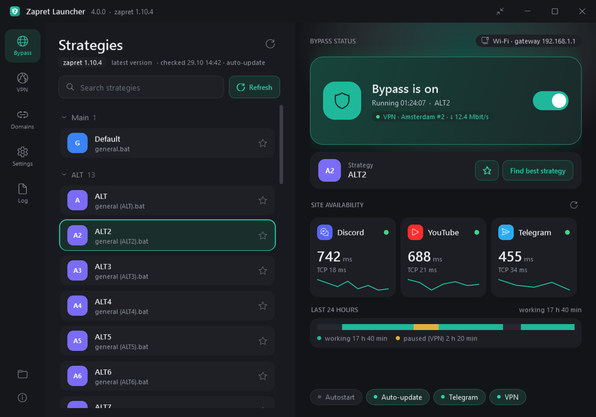
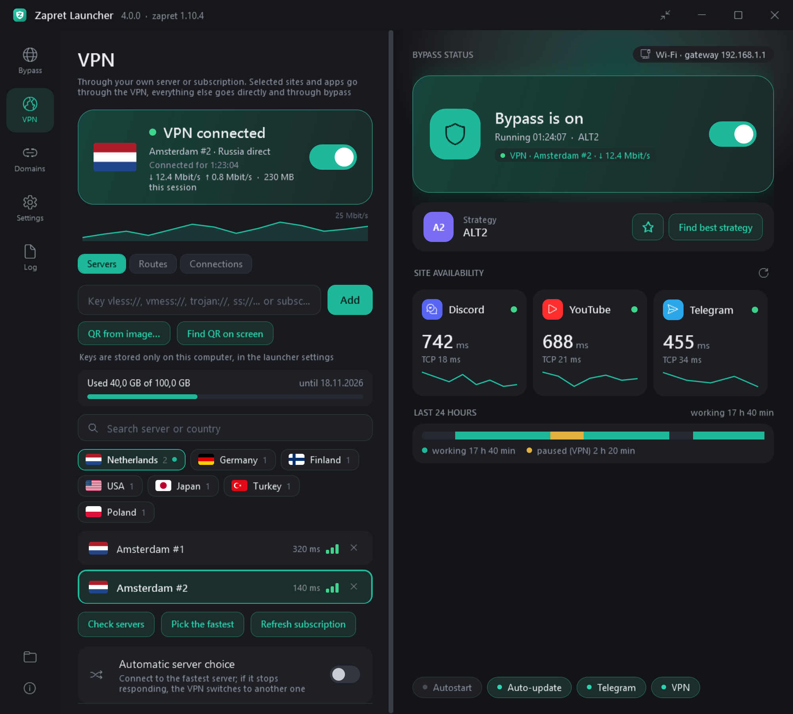
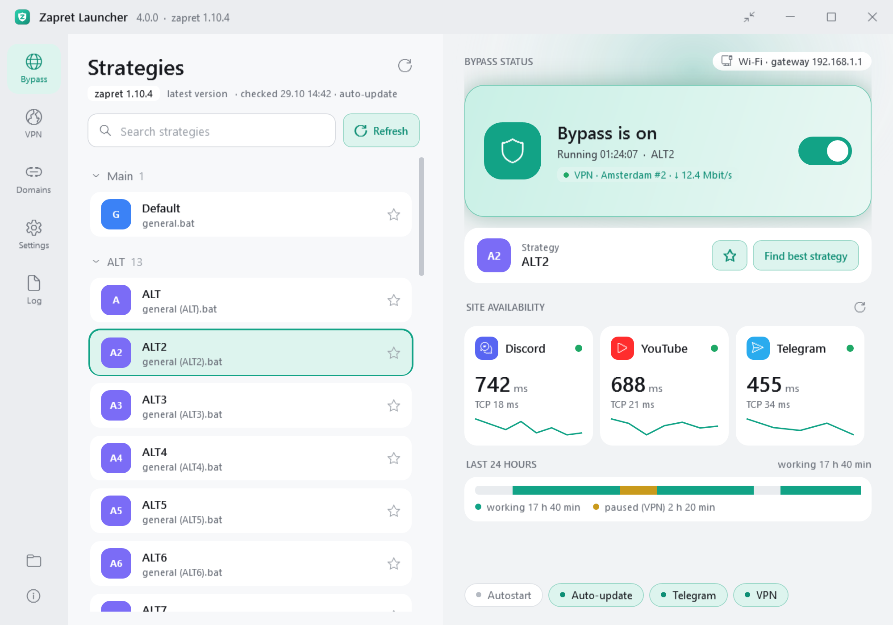
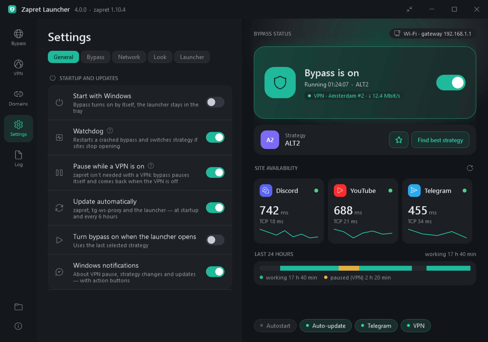
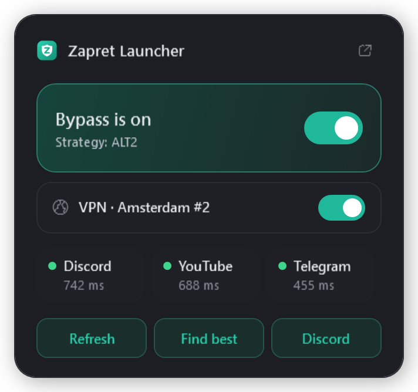

# Zapret Launcher

[Русский](README.ru.md) · **English**

**Discord, YouTube and Telegram working again — with one click.** Zapret Launcher is a friendly Windows app for [zapret-discord-youtube](https://github.com/Flowseal/zapret-discord-youtube) by Flowseal, with a built-in VPN client. No more `.bat` files, console windows or trying strategies by hand: the launcher finds one that works, keeps it up to date and fixes things when they break.

<p align="center">
  
</p>

<table>
  <tr>
    <td width="50%"></td>
    <td width="50%"></td>
  </tr>
  <tr>
    <td align="center">Built-in VPN: flags, ping, subscription</td>
    <td align="center">Light theme</td>
  </tr>
  <tr>
    <td width="50%"></td>
    <td width="50%" align="center"></td>
  </tr>
  <tr>
    <td align="center">Settings in tabs</td>
    <td align="center">Mini window by the tray — click the tray icon</td>
  </tr>
</table>

## Install in a minute

1. Download **ZapretLauncherSetup.exe** from [Releases](https://github.com/Pont1fe/zapret-launcher/releases/latest).
2. Run it and click “Install”. The launcher goes to `C:\ZapretLauncher` and downloads the latest zapret on first start.
3. Click the big on/off card — or “Find best strategy” and let the launcher find the one that works with your ISP.

> Windows SmartScreen may warn that the app is unsigned: “More info” → “Run anyway”. Antivirus software may flag the WinDivert driver that zapret needs — add the launcher folder to exclusions.

## What it does

### 🛡️ Bypass without the hassle
- **One button** and bypass is on. winws runs without a console window, the launcher lives in the tray.
- **Automatic strategy search**: tests every strategy against Discord, YouTube, YouTube video and Telegram and turns on the best one, with live progress on the card.
- **Watchdog**: restarts a crashed winws and picks a new strategy by itself when sites stop opening.
- **Per-network strategies**: home, mobile hotspot and the café Wi-Fi each remember what worked there.
- **Site cards** show whether Discord, YouTube and Telegram open and how fast; the “Last 24 hours” bar shows how bypass did all day.

### 🌍 Built-in VPN (new in 4.0)
- Paste a **vless / vmess / trojan / ss / hysteria2 / tuic** key, a subscription URL — or just **scan a QR code** from an image or straight from the screen.
- **Smart routing**: only the sites and apps you choose go through the VPN, or everything except Russian sites (“Russia direct” mode).
- **Real server check**: a real page is opened through every server, not just a ping. “Pick the fastest” and automatic failover to another server.
- Servers grouped by country with flags, subscription traffic and expiry, a speed graph and a live list of connections.
- Keys with the **xhttp** transport work through the Xray core, downloaded automatically.

### 💬 Telegram
- Desktop through the local [tg-ws-proxy](https://github.com/Flowseal/tg-ws-proxy), Web through hosts entries — one switch.

### ✨ Nice touches
- **Auto-update** of zapret, tg-ws-proxy and the launcher itself. Don't like a new version? Roll back with one click.
- **Secure DNS** (DNS over HTTPS), **Game Filter**, **IPSet** and your own domains right in the window, no `service.bat` needed.
- **Settings backup** to a file and back — handy when reinstalling Windows.
- Dark and light themes, accent color, interface scale, Mica background, compact view.
- Windows notifications with action buttons, start with Windows without a UAC prompt, taskbar icon menu.
- Russian and English interface; uninstall from Windows “Installed apps”.

## Build from source

Only Windows 10/11 is required — the C# compiler of .NET Framework 4.8 that ships with Windows is used:

```
powershell -ExecutionPolicy Bypass -File build.ps1
```

`ZapretLauncher.exe` and `ZapretLauncherSetup.exe` appear in `dist`. Releases are built by GitHub Actions: bump `AppVersion` in `app/App.cs`, update `RELEASE_NOTES.md` and push a tag `vX.Y.Z`.

- `app/` — the launcher (WPF): `Launcher.cs` window and logic, `Zapret.cs` zapret handling, `Vpn.cs` VPN (sing-box and Xray), `Telegram.cs`, `Network.cs` site and network checks, `Toast.cs` notifications, `I18n.cs` translation, `Shell.cs` icons, shortcuts, self-update, `ui.xaml` layout.
- `installer/` — the installer (WinForms).

## Credits

- [Flowseal/zapret-discord-youtube](https://github.com/Flowseal/zapret-discord-youtube) and [bol-van/zapret](https://github.com/bol-van/zapret) — the bypass itself.
- [Flowseal/tg-ws-proxy](https://github.com/Flowseal/tg-ws-proxy) — the Telegram Desktop proxy.
- [SagerNet/sing-box](https://github.com/SagerNet/sing-box) and [XTLS/Xray-core](https://github.com/XTLS/Xray-core) — the VPN cores.
- [ZXing.Net](https://github.com/micjahn/ZXing.Net) — QR code reading, [flagcdn.com](https://flagcdn.com) — country flags.

This is an unofficial wrapper; zapret, tg-ws-proxy, sing-box and Xray are downloaded directly from their authors' releases.
