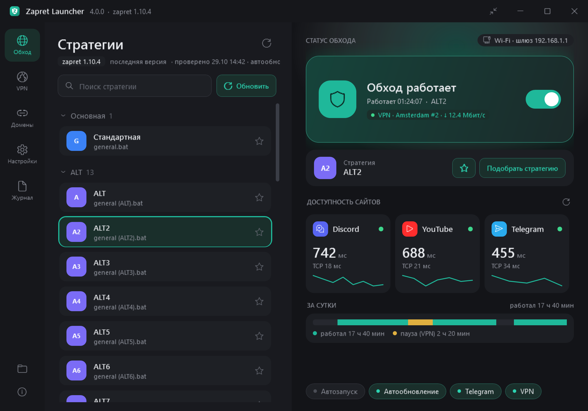
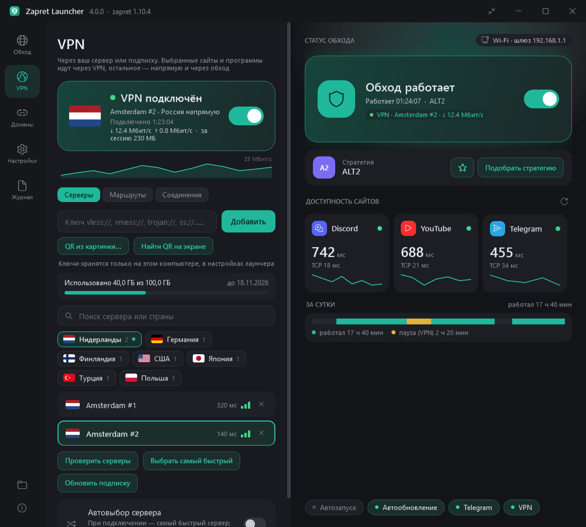
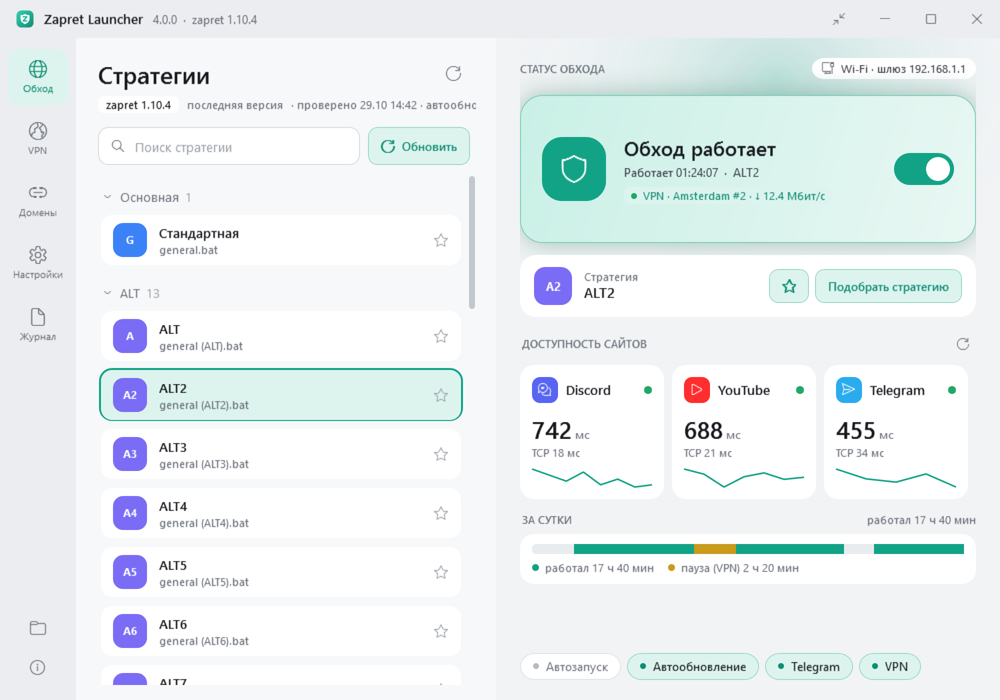
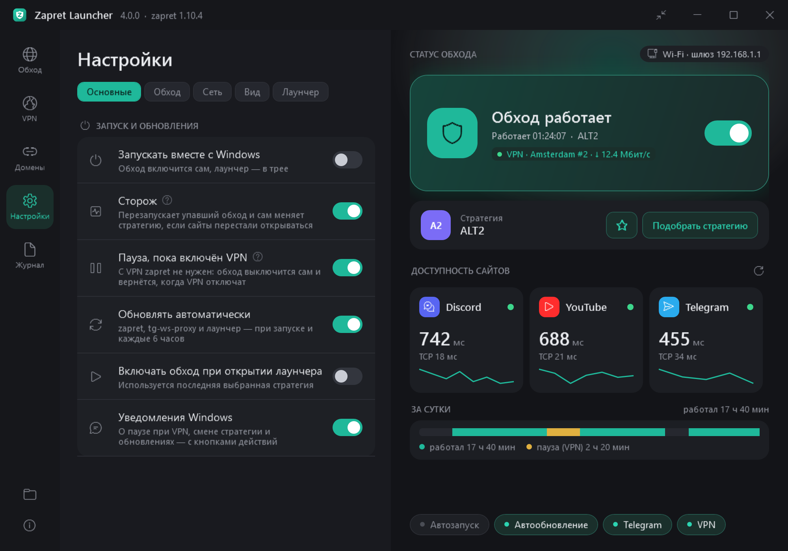
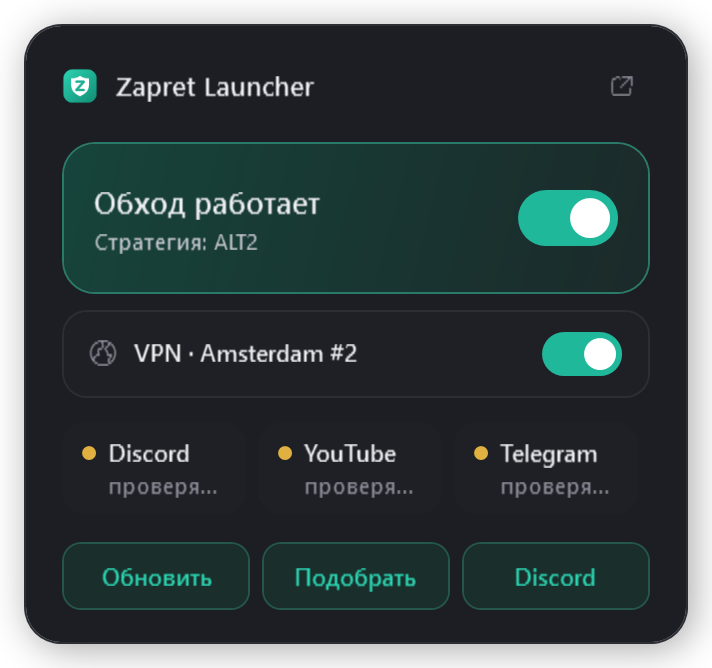

# Zapret Launcher

**Русский** · [English](README.md)

**Discord, YouTube и Telegram снова работают — одним нажатием.** Zapret Launcher — удобная оболочка для [zapret-discord-youtube](https://github.com/Flowseal/zapret-discord-youtube) (Flowseal) со встроенным VPN-клиентом. Больше никаких `.bat`-файлов, консольных окон и ручного перебора стратегий: лаунчер сам найдёт рабочую, сам её обновит и сам починит, если что-то сломается.

<p align="center">
  
</p>

<table>
  <tr>
    <td width="50%"></td>
    <td width="50%"></td>
  </tr>
  <tr>
    <td align="center">Встроенный VPN: флаги, пинг, подписка</td>
    <td align="center">Светлая тема</td>
  </tr>
  <tr>
    <td width="50%"></td>
    <td width="50%" align="center"></td>
  </tr>
  <tr>
    <td align="center">Настройки по вкладкам</td>
    <td align="center">Мини-окно у трея — открывается кликом по значку</td>
  </tr>
</table>

## Установка — минута

1. Скачайте **ZapretLauncherSetup.exe** со страницы [Releases](https://github.com/Pont1fe/zapret-launcher/releases/latest).
2. Запустите и нажмите «Установить». Лаунчер встанет в `C:\ZapretLauncher` и при первом запуске сам скачает свежий zapret.
3. Нажмите большую карточку-переключатель — или «Подобрать стратегию», и лаунчер сам найдёт ту, что работает у вашего провайдера.

> Windows SmartScreen может предупредить, что приложение не подписано: «Подробнее» → «Выполнить в любом случае». Антивирус может ругаться на драйвер WinDivert, без которого zapret не работает, — добавьте папку лаунчера в исключения.

## Что умеет

### 🛡️ Обход блокировок без возни
- **Одна кнопка** — и обход работает. winws запускается без консольного окна, лаунчер живёт в трее.
- **Автоподбор стратегии**: лаунчер по очереди проверяет все стратегии на Discord, YouTube, видео YouTube и Telegram и включает лучшую. Прогресс виден прямо на карточке.
- **Сторож** следит за обходом: упал winws — перезапустит, перестали открываться сайты — сам подберёт новую стратегию.
- **Своя стратегия для каждой сети**: дома, на мобильном интернете и в кафе лаунчер помнит, что работало именно здесь.
- **Карточки сайтов** показывают, открываются ли Discord, YouTube и Telegram и за сколько миллисекунд, а полоска «За сутки» — как работал обход весь день.

### 🌍 Встроенный VPN (новое в 4.0)
- Вставьте ключ **vless / vmess / trojan / ss / hysteria2 / tuic**, адрес подписки или просто **отсканируйте QR-код** — с картинки или прямо с экрана.
- **Умная маршрутизация**: через VPN идут только нужные сайты и программы, или всё, кроме российских сайтов (режим «Россия напрямую»), — банки и Госуслуги работают как обычно.
- **Честная проверка серверов**: через каждый открывается настоящая страница, а не просто пинг. «Выбрать самый быстрый» и автовыбор с переключением, если сервер упал.
- Серверы по странам с флагами, трафик и срок подписки, график скорости и живой журнал соединений.
- Ключи с транспортом **xhttp** работают через ядро Xray — оно скачается само.

### 💬 Telegram
- Desktop работает через локальный [tg-ws-proxy](https://github.com/Flowseal/tg-ws-proxy), Web — через записи в hosts. Всё включается одним переключателем.

### ✨ И приятные мелочи
- **Автообновление** zapret, tg-ws-proxy и самого лаунчера. Не понравилась новая версия — верните прошлую одной кнопкой.
- **Защищённый DNS** (DNS over HTTPS), **Game Filter**, **IPSet** и свои домены — прямо в окне, без `service.bat`.
- **Резервная копия настроек** в файл и обратно — удобно при переустановке Windows.
- Тёмная и светлая темы, цвет акцента, масштаб, прозрачный фон Mica, компактный вид.
- Уведомления Windows с кнопками действий, автозапуск без запроса UAC, меню на значке в панели задач.
- Русский и английский интерфейс; удаление через «Установленные приложения» Windows.

## Сборка из исходников

Нужен только Windows 10/11: используется встроенный компилятор C# из .NET Framework 4.8.

```
powershell -ExecutionPolicy Bypass -File build.ps1
```

Готовые `ZapretLauncher.exe` и `ZapretLauncherSetup.exe` появятся в папке `dist`. Релизы собирает GitHub Actions: поменяйте `AppVersion` в `app/App.cs`, обновите `RELEASE_NOTES.md` и отправьте тег `vX.Y.Z`.

- `app/` — лаунчер (WPF): `Launcher.cs` — окно и логика, `Zapret.cs` — работа с zapret, `Vpn.cs` — VPN (sing-box и Xray), `Telegram.cs`, `Network.cs` — проверки сайтов и сети, `Toast.cs` — уведомления, `I18n.cs` — перевод, `Shell.cs` — значки, ярлыки, самообновление, `ui.xaml` — интерфейс.
- `installer/` — установщик (WinForms).

## Благодарности

- [Flowseal/zapret-discord-youtube](https://github.com/Flowseal/zapret-discord-youtube) и [bol-van/zapret](https://github.com/bol-van/zapret) — сам обход.
- [Flowseal/tg-ws-proxy](https://github.com/Flowseal/tg-ws-proxy) — прокси для Telegram Desktop.
- [SagerNet/sing-box](https://github.com/SagerNet/sing-box) и [XTLS/Xray-core](https://github.com/XTLS/Xray-core) — ядра VPN.
- [ZXing.Net](https://github.com/micjahn/ZXing.Net) — чтение QR-кодов, [flagcdn.com](https://flagcdn.com) — флаги стран.

Лаунчер — неофициальная оболочка; zapret, tg-ws-proxy, sing-box и Xray скачиваются напрямую из релизов их авторов.
