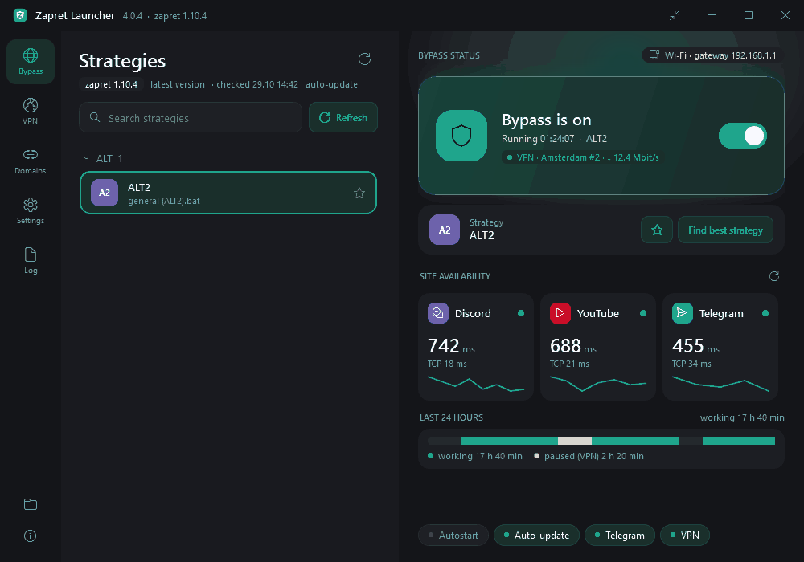

**Download `ZapretLauncherSetup.exe`** — installs or updates the launcher (settings and zapret are kept). Installed launchers update themselves automatically.
**Скачайте `ZapretLauncherSetup.exe`** — установит или обновит лаунчер (настройки и zapret сохранятся). Установленные лаунчеры обновятся сами.

### 4.0.7 — Locked for real / Защита до конца

- 🔐 The launcher folder protection from 4.0.6 is now complete: the folder's owner also becomes Administrators. Before, if the folder had been created without admin rights (for example, when unpacking an old version by hand), its owner could take the write access back without admin rights / Защита папки лаунчера из 4.0.6 доведена до конца: владельцем папки тоже становятся администраторы. Раньше, если папку создавали без прав администратора (например, распаковывая старую версию вручную), её владелец мог вернуть себе право на запись и без прав администратора
- 🖱️ The taskbar icon menu works even when the launcher runs under another account (a standard user enters an administrator's password) / Меню на значке в панели задач работает, даже если лаунчер запущен от другой учётной записи (обычный пользователь вводит пароль администратора)
- 📝 The log shows how many subscription servers were skipped because the launcher doesn't support them, and why / В журнале видно, сколько серверов подписки пропущено, потому что лаунчер их не поддерживает, и почему
- 🧹 Under the hood: server ordering, the fastest-server pick and the speed-test candidates live in one tested place instead of three copies; new tests for frozen system tools / Внутри: порядок серверов, выбор самого быстрого и серверы для замера скорости — в одном месте с тестами вместо трёх копий; новые тесты на зависание системных утилит

### 4.0.6 — Safer / Надёжнее

- 🔐 Only an administrator can now change the launcher folder. Before, any program on the computer could swap the launcher or a strategy there — and they run with admin rights. The launcher fixes the folder permissions by itself on the first start. Note: to edit zapret files by hand (for example, lists in `zapret\lists`), open Notepad as administrator — editing through the launcher works as before / Папку лаунчера теперь может менять только администратор. Раньше любая программа на компьютере могла подменить в ней лаунчер или стратегию, а они запускаются с правами администратора. Лаунчер сам поправит права папки при первом запуске. Учтите: чтобы править файлы zapret вручную (например, списки в `zapret\lists`), откройте Блокнот от имени администратора — через лаунчер всё работает как раньше
- 💾 Settings are saved more safely: a power cut in the middle of saving no longer wipes your VPN keys, and if the settings file does get damaged, the launcher keeps it and offers to restore the backup / Настройки сохраняются надёжнее: сбой питания посреди сохранения больше не сотрёт ключи VPN, а если файл настроек всё же повредится, лаунчер сохранит его и предложит восстановить копию
- 🗑️ Uninstalling removes only the launcher's own files, not the whole folder; the installer no longer installs into a folder that already has other files / Удаление стирает только файлы лаунчера, а не всю папку; установщик больше не ставит лаунчер в папку, где уже лежат другие файлы
- 🌐 A subscription is added even if the provider put a server the launcher doesn't support into it — that server is just skipped / Подписка добавляется, даже если провайдер положил в неё сервер, который лаунчер не поддерживает, — такой сервер просто пропускается
- 🧭 Secure DNS leaves adapters with a manually set DNS (Pi-hole, a work DNS) alone, so turning it off doesn't lose them / Защищённый DNS не трогает адаптеры, где DNS прописан вручную (Pi-hole, рабочий DNS), — при выключении он не потеряется
- ⚙️ Updated site sets apply right away; system tools can no longer freeze the window; big subscriptions with many xhttp servers are checked in batches / Обновлённые наборы сайтов применяются сразу; зависшая системная утилита больше не может заморозить окно; большие подписки с множеством серверов xhttp проверяются пачками

### 4.0.5 — VPN at your fingertips / VPN под рукой

- ⚡ “Test speed” under the server list: the launcher downloads a test file through the selected server and the fastest ones (up to 5, 5 seconds each) and shows Mbit/s next to the ping. It runs through a separate test core — your VPN keeps working and isn't reconnected / Кнопка «Проверить скорость» под списком серверов: лаунчер качает тестовый файл через выбранный сервер и самые быстрые (до 5, по 5 секунд на каждый) и показывает Мбит/с рядом с пингом. Замер идёт через отдельное тестовое ядро — ваш VPN работает и не переподключается
- 🖱️ The tray icon menu now has “VPN server” (pick the fastest or any server, fastest on top) and “VPN mode” — no need to open the window / В меню значка в трее — «Сервер VPN» (самый быстрый или любой, быстрые сверху) и «Режим VPN»: окно открывать не нужно
- ⏰ A reminder 3 days and 1 day before the VPN subscription ends, when it has ended, and when 90% and all of its traffic is used. Each once; before reminding, the launcher re-checks the subscription in case you've already renewed it / Напоминание за 3 дня и за сутки до конца подписки VPN, когда она закончилась, и когда израсходовано 90% и весь трафик. Каждое — один раз; перед напоминанием лаунчер перепроверит подписку — вдруг вы её уже продлили
- 📤 Export and import of VPN routes on the Routes tab: your sites and apps in a plain .txt — move them to another computer or share them (there are no keys in the file) / Экспорт и импорт маршрутов VPN на вкладке «Маршруты»: ваши сайты и программы в обычном .txt — перенесите на другой компьютер или поделитесь (ключей в файле нет)
- 🔄 Ready-made site sets update themselves: when a service adds a new domain, it lands in the sets you've turned on — without a new launcher version / Готовые наборы сайтов обновляются сами: если у сервиса появился новый домен, он попадёт во включённые у вас наборы — без новой версии лаунчера
- 🐞 “Report a problem” on the Log page saves the report and opens a GitHub issue with the versions already filled in. Server addresses are now left out of the report too / «Сообщить о проблеме» в журнале: сохраняет отчёт и открывает заявку на GitHub с уже заполненными версиями. Адреса серверов теперь тоже не попадают в отчёт

### 4.0.4 — VPN without leaks / VPN без утечек

- 🔒 “Never bypass the VPN” on the Routes tab: if the VPN goes down and won't come back, the launcher blocks the listed sites and apps instead of letting them go directly (in “All traffic” and “Russia direct” — everything that went through the VPN). The VPN card shows the blocking; it lifts by itself once the VPN works again / «Не пускать мимо VPN» на вкладке «Маршруты»: если VPN упал и не поднимается, лаунчер не пускает сайты и программы из списка напрямую (в режимах «Весь трафик» и «Россия напрямую» — всё, что шло через VPN). Карточка VPN показывает блокировку, а когда VPN заработает, она снимется сама
- 📶 Server list: after a check working servers go on top, fastest first; dead ones can be hidden with one button — the selected server always stays visible / Список серверов: после проверки работающие — наверху, самые быстрые первыми; неработающие можно скрыть одной кнопкой — выбранный сервер виден всегда
- 🧾 “Save report” on the Log page: logs and system info in one archive on the desktop, to send when something doesn't work. VPN keys, the subscription URL, settings files and your Windows user name are left out / Кнопка «Собрать отчёт» в журнале: журналы и сведения о системе одним архивом на рабочий стол — чтобы отправить, если что-то не работает. Ключи VPN, адрес подписки, файлы настроек и имя пользователя Windows в него не попадают
- 📸 Fresh screenshots in the README / Свежие скриншоты в README

### 4.0.3 — AmneziaWG / AmneziaWG

- 🛡️ AmneziaWG servers, Amnezia Premium included: in the Amnezia app open your subscription → “Configuration files”, download the file for a country and add it with the new “AmneziaWG file…” button (or just copy its text — the launcher offers to add it). The official AmneziaWG core downloads itself, is checked by its checksum and is updated together with the other cores / Серверы AmneziaWG, в том числе Amnezia Premium: в приложении Amnezia откройте подписку → «Файлы конфигурации», скачайте файл нужной страны и добавьте его новой кнопкой «Файл AmneziaWG…» (или просто скопируйте его текст — лаунчер предложит добавить). Официальное ядро AmneziaWG скачивается само, проверяется по контрольной сумме и обновляется вместе с остальными ядрами
- 🌍 “All traffic” mode works with AmneziaWG; “Selected only” and “Russia direct” with it are experimental for now — after connecting, the launcher checks that sites open and writes the result to the log / С AmneziaWG работает режим «Весь трафик»; «Только выбранное» и «Россия напрямую» с ним — пока экспериментально: после подключения лаунчер проверяет, открываются ли сайты, и пишет итог в журнал
- 🔑 A pasted vpn:// key from AmneziaVPN now explains where to get the file the launcher can use / Если вставить ключ vpn:// от AmneziaVPN, лаунчер подскажет, где взять файл, который он умеет открывать
- 😌 A quieter watchdog: when a site doesn't open, it rechecks it right away with a longer timeout and counts a failure only if that fails too; one-off glitches no longer fill the log / Сторож тише: если сайт не открылся, он сразу перепроверяет его с запасом по времени и засчитывает неудачу, только если не вышло и во второй раз; разовые сбои больше не засоряют журнал
- 🔧 Fixed: a server picked while the VPN was reconnecting could be ignored — the card showed it while the VPN kept using the old one; now the launcher reconnects to the selected server by itself, and the log says which server the VPN is connected through. App names with | < > in VPN routes no longer cause an error / Исправлено: сервер, выбранный, пока VPN переподключался, мог не примениться — карточка показывала его, а VPN работал через прежний; теперь лаунчер сам переподключается на выбранный, а в журнале видно, через какой сервер подключён VPN. Имена программ с | < > в маршрутах VPN больше не вызывают ошибку
- 🧪 Under the hood: the code is split into files by area and covered by 186 automatic tests that run on every build — a release won't go out if one of them fails / Внутри: код разложен по файлам, его проверяют 186 автотестов при каждой сборке — если какой-то не пройдёт, релиз не выйдет

### 4.0.2 — sites in sets / Сайты наборами

- 📦 Ready-made sets on the Domains page and in VPN routes: YouTube, Discord, Telegram, WhatsApp, Instagram, Spotify, Netflix and more — one click adds every domain of the service (and its app for the VPN), another click removes it; sets are sorted into tabs — Chat, Media, Social, Work, AI / Готовые наборы на странице «Домены» и в маршрутах VPN: YouTube, Discord, Telegram, WhatsApp, Instagram, Spotify, Netflix и другие — одно нажатие добавляет все домены сервиса (а для VPN — и его программу), второе убирает; наборы разложены по вкладкам — Общение, Медиа, Соцсети, Работа, ИИ
- 🤖 AI services for the VPN: ChatGPT, Gemini, Grok, Perplexity, Copilot / ИИ-сервисы для VPN: ChatGPT, Gemini, Grok, Perplexity, Copilot
- 📋 Add many at once: paste a multi-line list into the field or load a .txt file — comments and IP addresses from hosts-style lists are skipped / Сразу много: вставьте в поле список из нескольких строк или загрузите файл .txt — комментарии и IP-адреса из списков в стиле hosts пропускаются
- 🗂️ Sets show up in the lists as one card with the service icon instead of a dozen lines; long lists get a search box / Наборы в списках — одной карточкой со значком сервиса вместо десятка строк; у длинных списков появился поиск
- 📜 A readable log: errors in red, warnings in yellow, search, an “Important only” filter, Copy and Open file buttons / Журнал читается легко: ошибки красным, предупреждения жёлтым, поиск, фильтр «Только важное», кнопки «Копировать» и «Открыть файл»
- 🐕 If the watchdog switches the strategy, the bar on the right shows what changed and brings the old one back in one click; sites going through the VPN no longer make it switch / Если сторож сменил стратегию — плашка справа покажет, на какую, и вернёт прежнюю одной кнопкой; из-за сайтов, идущих через VPN, он стратегию больше не меняет
- 😌 A calmer watchdog: rechecks every 2 minutes, waits about 8 minutes when only one site fails (4 when several do), first just restarts the current strategy, and searches for a new one at most once per half hour / Сторож спокойнее: перепроверяет раз в 2 минуты, из-за одного сайта ждёт около 8 минут (из-за нескольких — 4), сначала просто перезапускает текущую стратегию и подбирает новую не чаще раза в полчаса
- 🔔 Fixed: Windows notifications never showed up; the tray mini window crashed when the VPN was already connected; app paths with spaces in VPN routes were split apart; the window's right edge was cut off at its minimum width; a change made while bypass or the VPN was restarting (say, a few quick clicks on sets) waited until the next restart / Исправлено: уведомления Windows не показывались; мини-окно у трея падало, если VPN уже подключён; пути программ с пробелами в маршрутах VPN разрезались; при минимальной ширине окна обрезался правый край; изменение, сделанное, пока обход или VPN перезапускался (например, несколько быстрых нажатий на наборы), применялось только при следующем перезапуске

### 4.0.1 — smarter about blocks / Умнее с блокировками

- 🚧 Sites your ISP blocks by address (zapret can't help there) are now detected: the card says “blocked by address — VPN will help”, and one “Via VPN” button on the Routes tab sends the whole service through the VPN / Сайты, которые провайдер блокирует по адресу (тут zapret бессилен), теперь распознаются: на карточке — «заблокирован по адресу — поможет VPN», а кнопка «Через VPN» на вкладке «Маршруты» пускает весь сервис через VPN
- 🐕 The watchdog no longer keeps picking new strategies because of such sites / Сторож больше не гоняет подбор стратегий из-за таких сайтов
- 🛠️ A “Fix” button on the warning bar: closes other bypass programs, stops their services and unloads a foreign WinDivert driver / Кнопка «Исправить» на жёлтой плашке: закроет другие программы обхода, остановит их службы и выгрузит чужой драйвер WinDivert
- 📊 Connections grouped by app, with real app icons and traffic per app / Журнал соединений по программам — с настоящими значками и трафиком каждой
- ✨ Smooth transitions between pages and tabs; a new welcome tour with pictures of the VPN and routing modes / Плавные переходы между страницами и вкладками; новое приветствие с картинками про VPN и режимы маршрутов

### 4.0.0 — VPN right inside the launcher / VPN прямо в лаунчере

The biggest update yet: zapret and a VPN now live in one window and work together. No separate VPN app needed.
Самое большое обновление: zapret и VPN теперь в одном окне и работают вместе. Отдельное VPN-приложение больше не нужно.

**🌍 Built-in VPN / Встроенный VPN**
- Paste a vless / vmess / trojan / ss / hysteria2 / tuic key or a subscription URL — or just scan a QR code from an image or straight off the screen / Вставьте ключ vless / vmess / trojan / ss / hysteria2 / tuic или адрес подписки — или просто отсканируйте QR-код с картинки или прямо с экрана
- Copied a key? The launcher notices it and offers to add it / Скопировали ключ? Лаунчер заметит и предложит добавить
- Keys with the xhttp transport work too — the Xray core downloads itself when needed / Работают и ключи с транспортом xhttp — ядро Xray скачается само, когда понадобится

**🧭 Smart routing / Умная маршрутизация**
- Only the sites and apps you choose go through the VPN; everything else goes directly and through zapret / Через VPN идут только выбранные сайты и программы, остальное — напрямую и через zapret
- “Russia direct”: Russian sites go directly, the rest through the VPN — banks and Gosuslugi keep working / «Россия напрямую»: российские сайты — напрямую, остальное — через VPN, банки и Госуслуги работают как обычно
- Or send all traffic through the VPN with one click / Или весь трафик через VPN одной кнопкой

**⚡ Servers / Серверы**
- Honest check: a real page is opened through every server, not just a ping; signal bars show who's fast / Честная проверка: через каждый сервер открывается настоящая страница, а не просто пинг; полоски сигнала сразу показывают, кто быстрый
- “Pick the fastest” and auto-choice: if a server goes down, the VPN hops to another one / «Выбрать самый быстрый» и автовыбор: если сервер упал, VPN сам перейдёт на другой
- Servers grouped by country with flags and search; subscription traffic and expiry, auto-refresh once a day / Серверы по странам с флагами и поиском; трафик и срок подписки, автообновление раз в сутки
- Live list of connections: see what goes through the VPN and what goes direct / Живой журнал соединений: видно, что идёт через VPN, а что напрямую

**🎨 New look / Новый вид**
- A big VPN card with the country flag, connection timer and speed graph — tap it to connect / Большая карточка VPN с флагом страны, временем подключения и графиком скорости — нажмите, чтобы подключиться
- Settings split into tabs with icons, a tidier right panel, “How to start” hints for VPN newcomers / Настройки разложены по вкладкам со значками, правая панель стала аккуратнее, для новичков — подсказка «Как начать»
- New logo — a shield with a Z — and a blue VPN mark on the tray icon; VPN switch in the tray mini window / Новый логотип — щит с буквой Z — и синяя метка VPN на значке трея; переключатель VPN в мини-окне у трея

**🔙 Safety net / Подстраховка**
- Didn't like an update? Roll the launcher back to the previous version in Settings → Launcher; your settings are backed up first / Не понравилось обновление? Верните прошлую версию лаунчера в Настройках → Лаунчер, настройки перед этим сохранятся
- “What's new” window after every update / Окно «Что нового» после каждого обновления

### 3.4.0
- Settings backup: save to / restore from a file; an automatic copy outside the launcher folder is offered back after reinstalling / Резервная копия настроек: сохранение в файл и восстановление; автокопия вне папки лаунчера — после переустановки лаунчер предложит её вернуть
- Secure DNS (Settings → DNS): Cloudflare, Google, Quad9 or AdGuard with DNS over HTTPS on Windows 11; restores automatic DNS if the server doesn't respond / Защищённый DNS (Настройки → DNS): Cloudflare, Google, Quad9 или AdGuard с шифрованием DNS через HTTPS в Windows 11; если сервер не отвечает, DNS возвращается автоматический
- Check any site on the Domains page: does it open, how fast, is DNS spoofed / Проверка любого сайта на странице «Домены»: открывается ли, за сколько, не подменён ли DNS
- The IPSet list updates itself weekly / Список IPSet обновляется сам раз в неделю

### 3.3.3
- “Exit” in the tray menu now turns bypass and the Telegram proxy off before closing the launcher (restarts after updates still keep bypass running) / «Выход» в меню трея теперь выключает обход и Telegram-прокси перед закрытием лаунчера (при перезапуске после обновления обход по-прежнему не прерывается)
- Fixed the installer crashing on start / Исправлено падение установщика при запуске

### 3.3.2
- Sharp tray icon at any display scale, crisper small text, multi-size window icon / Чёткий значок в трее при любом масштабе экрана, резкий мелкий текст, значок окна во всех размерах
- Taskbar icon menu (right click): turn bypass on/off, find a strategy, fix Discord, favorite strategies — without UAC prompts / Меню на значке в панели задач (правый клик): включить и выключить обход, подбор, «Починить Discord», избранные стратегии — без запроса UAC
- Quick search among starred strategies (star button next to “Find best strategy”) / Быстрый подбор по избранным стратегиям (кнопка со звёздочкой рядом с «Подобрать стратегию»)
- If fewer sites open after a zapret auto-update, the launcher offers to restore the previous version / Если после автообновления zapret сайтов открывается меньше, лаунчер предложит вернуть прошлую версию
- On Windows start, bypass waits for the internet to come up / При запуске Windows обход ждёт появления интернета
- Compact view (button in the title bar), splash screen, loading ring on the switch, site cards lift on hover and open the site on click, sliding menu highlight / Компактный вид (кнопка в заголовке), заставка при запуске, кольцо загрузки на переключателе, карточки сайтов приподнимаются при наведении и открывают сайт по клику, плавная подсветка меню
- Fixed: site cards were empty when the launcher opened with bypass off / Исправлено: карточки сайтов были пустыми, если открыть лаунчер с выключенным обходом

### 3.3.1
- The window can be resized and maximized; size and position are remembered / Окно можно растягивать и разворачивать на весь экран, размер запоминается
- 24-hour history: when bypass worked, was paused for VPN or failed / История за сутки: когда обход работал, стоял на паузе из-за VPN или давал сбой
- Larger site cards with service icons, big ping numbers and full-width charts / Крупные карточки сайтов: значки сервисов, пинг крупным числом, график на всю ширину
- The switch card turns yellow on VPN pause and red on errors, glows while working and sends a wave when turned on / Карточка-переключатель желтеет при паузе и краснеет при ошибке, «дышит» во время работы и пускает волну при включении
- Strategy groups collapse; hovering a strategy shows the last search results per site / Группы стратегий сворачиваются, при наведении на стратегию видны результаты последнего подбора по сайтам
- Accent color choice, interface scale 90–130%, smooth theme switching, “?” hints for complex settings / Выбор цвета акцента, масштаб интерфейса 90–130%, плавная смена темы, подсказки «?» к сложным настройкам
- The taskbar icon changes color like the tray icon; the tray mini window shows the state and has a Discord fix button / Значок в панели задач меняет цвет как в трее; мини-окно показывает состояние и умеет чинить Discord
- “Refresh ping” is now just “Refresh”; removed the duplicate zapret folder button / «Обновить пинг» теперь просто «Обновить»; убрана повторяющаяся кнопка папки zapret

### 3.3.0
- Tray icon shows the state: teal — working, yellow — paused for VPN, red — error, grey — off / Значок в трее показывает состояние: бирюзовый — работает, жёлтый — пауза из-за VPN, красный — ошибка, серый — выключен
- Strategy search is about twice as fast and shows live progress: a bar on the switch card, the taskbar icon, site cards and marks in the list / Подбор стратегии примерно вдвое быстрее и показывает прогресс вживую: полоска на карточке, значок в панели задач, карточки сайтов и метки в списке
- After sleep or a network change, bypass is checked right away / После сна и смены сети обход проверяется сразу
- Less memory and fewer background checks while in the tray or on battery; faster start / Меньше памяти и реже фоновые проверки в трее и от батареи; быстрее запуск
- Downloads of zapret, tg-ws-proxy and the launcher are verified by SHA-256 / Загрузки zapret, tg-ws-proxy и лаунчера проверяются по SHA-256
- Telegram entries in hosts are restored if an antivirus removes them / Записи Telegram в hosts восстанавливаются, если их удалил антивирус
- “Fix Discord” in Settings and the tray menu: closes Discord, clears its cache and reopens it / «Починить Discord» в настройках и меню трея: закрывает Discord, чистит кэш и открывает заново
- The log is limited to 1 MB / Журнал ограничен 1 МБ

### 3.2.1
- Fixed black text in the strategy and domain lists on some systems / Исправлен чёрный текст в списках стратегий и доменов на некоторых системах
- Screenshots on the project page / Скриншоты на странице проекта

### 3.2.0
- Light theme, “As in Windows” mode and optional Mica background / Светлая тема, режим «Как в Windows» и прозрачный фон Mica
- Mini window by the tray, styled dialogs, animations, ping history, strategy groups and favorites, welcome tour / Мини-окно у трея, свои диалоги, анимации, график пинга, группы и избранное стратегий, приветствие

Windows SmartScreen may warn about an unsigned app: “More info” → “Run anyway”.
SmartScreen может предупредить о неподписанном приложении: «Подробнее» → «Выполнить в любом случае».
